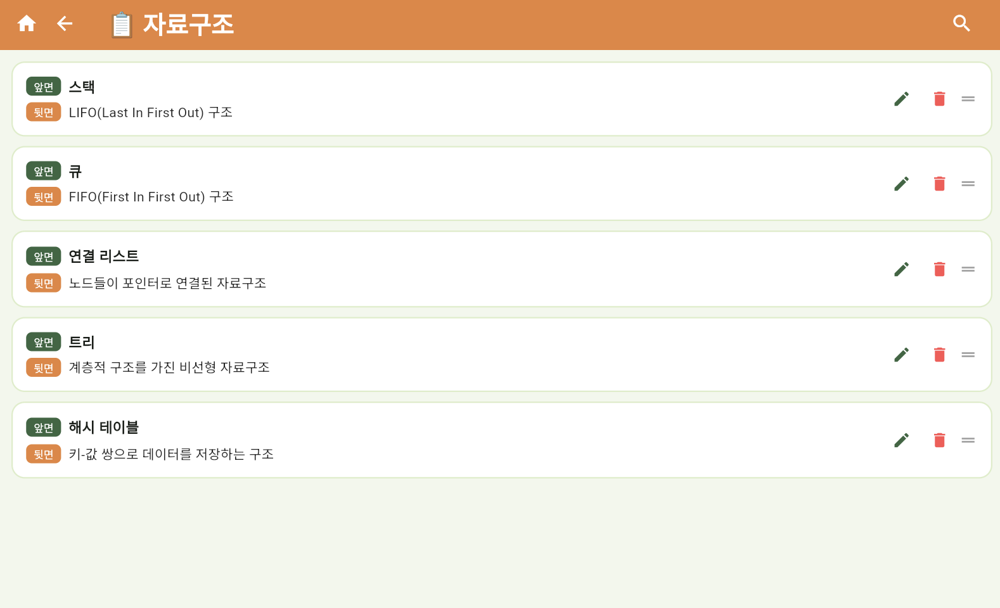
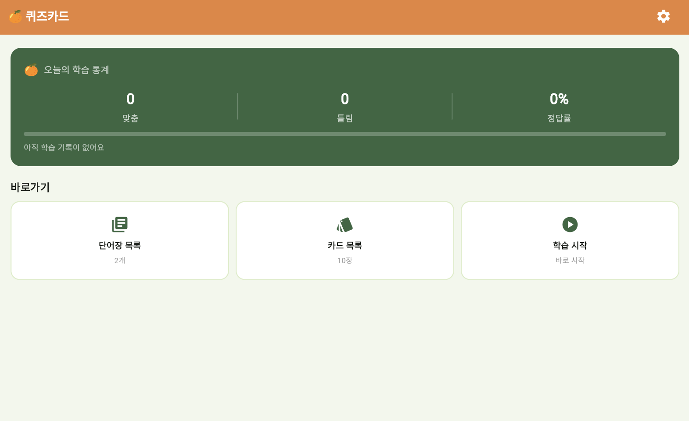
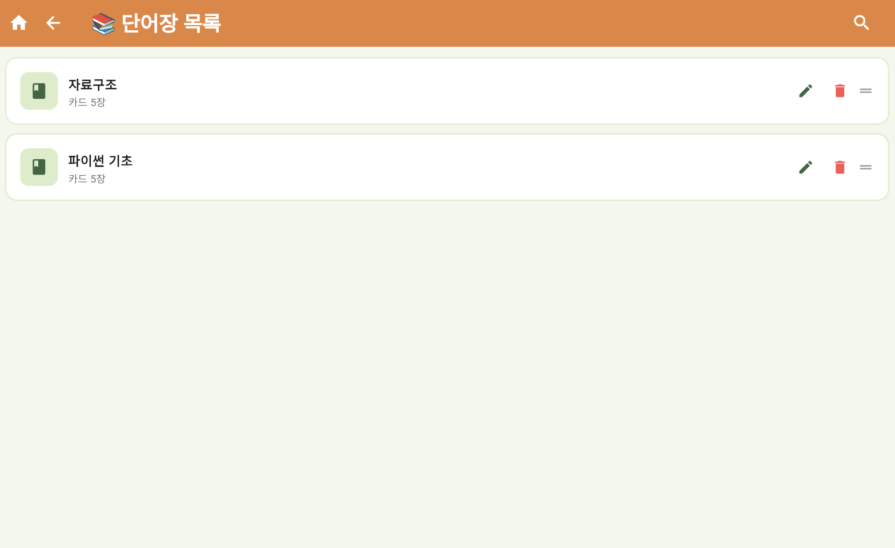
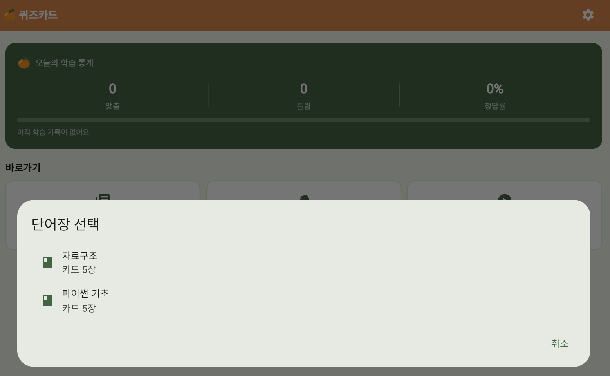
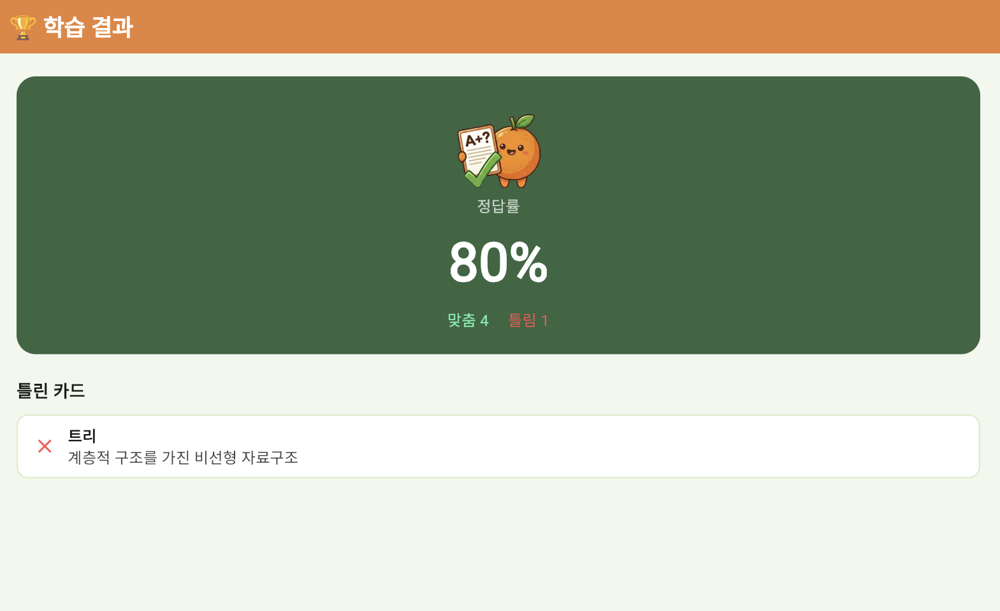
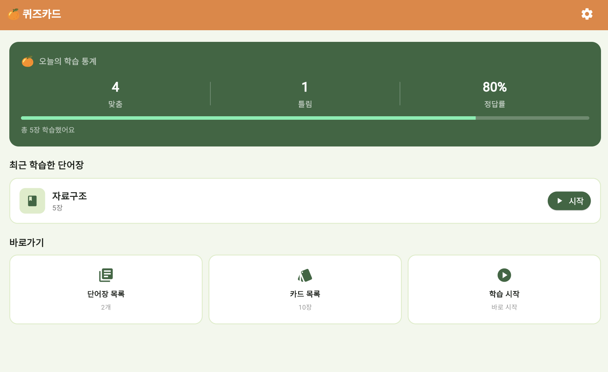
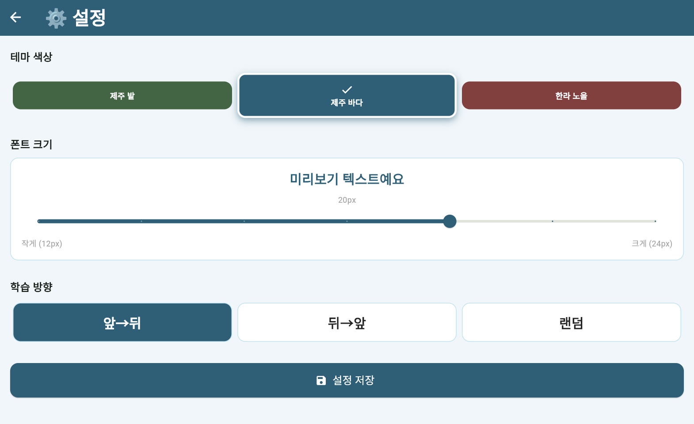

# Card Quiz

Flutter로 만든 플래시카드 단어장 학습 웹 앱.

라인편집기(Line Editor)의 추가, 삭제, 수정, 저장, 불러오기 개념을 단어장 앱에 응용한 CRUD 중심 프로젝트.




## 핵심 코드

### 카드 CRUD

[card_list_screen.dart](lib/screens/card_list_screen.dart) · [이론 정리: 줄 편집기](https://github.com/Jenny5789/python/blob/main/study_archive/data_structures/02_line_editor.py)

줄 편집기가 한 줄씩 넣고, 고치고, 지우듯이 단어장의 카드 리스트를 같은 방식으로 조작.

```dart
// 추가 (줄 편집기 insert)
widget.deck.cards.add(CardItem(
  front: frontController.text,
  back: backController.text,
));

// 수정 (줄 편집기 replace)
card.front = frontController.text;
card.back = backController.text;

// 삭제 (줄 편집기 delete)
widget.deck.cards.remove(card);

// 순서 변경
final card = widget.deck.cards.removeAt(oldIndex);
widget.deck.cards.insert(newIndex, card);

// 모든 변경 뒤 저장 요청
widget.onCardsChanged();
```

- 앞면이 비어 있으면 추가, 수정을 막고 SnackBar로 안내
- 자식 화면은 onCardsChanged 콜백으로 변경만 알리고, 저장은 HomeScreen에서 한 번에 처리

### 저장과 불러오기

[storage_service.dart](lib/services/storage_service.dart) · [deck.dart](lib/models/deck.dart) · [이론 정리: 클래스와 객체지향](https://github.com/Jenny5789/python/blob/main/study_archive/theory/14_classes_oop.md)

줄 편집기의 save, load처럼 단어장 전체를 JSON 문자열로 바꿔 브라우저 저장소(SharedPreferences)에 저장하고, 앱을 켤 때 다시 객체로 복원.

```dart
static Future<void> saveDecks(List<Deck> decks) async {
  final prefs = await SharedPreferences.getInstance();
  await prefs.setString(_decksKey,
      jsonEncode(decks.map((d) => d.toJson()).toList()));
}

static Future<List<Deck>> loadDecks() async {
  final prefs = await SharedPreferences.getInstance();
  final json = prefs.getString(_decksKey);
  if (json == null) {                       // 처음 실행이면 샘플 단어장 생성
    final sampleDecks = _createSampleDecks();
    await saveDecks(sampleDecks);
    return sampleDecks;
  }
  return (jsonDecode(json) as List).map((d) => Deck.fromJson(d)).toList();
}
```

- Deck, CardItem 클래스에 toJson, fromJson을 두어 객체와 JSON을 서로 변환
- 처음 실행하면 샘플 단어장 2개(자료구조, 파이썬 기초) 생성

## 주요 기능

테마, 글자 크기, 학습 방향은 ChangeNotifier를 [상속](https://github.com/Jenny5789/python/blob/main/study_archive/theory/14_classes_oop.md)한 AppSettings를 Provider로 주입해 앱 전체에 바로 반영.

| 기능 | 설명 |
|---|---|
| 단어장, 카드 관리 | 추가, 수정, 삭제, 드래그 순서 변경, 검색 |
| 학습 | 카드를 탭해 뒤집고 맞춤/틀림 체크<br>학습 방향: 앞→뒤, 뒤→앞(앞뒤를 바꾼 복사본으로 출제), 랜덤(shuffle) |
| 학습 결과, 오답 복습 | 정답률과 틀린 카드 목록 표시, 틀린 카드만 모아 다시 학습 |
| 오늘의 학습 통계 | 홈 화면에 맞춤, 틀림, 정답률, 최근 학습한 단어장 표시 |
| 설정 | 테마 색상 3종(제주 밭, 제주 바다, 한라 노을), 글자 크기, 학습 방향 |
| 온보딩 | 첫 실행 시 앱 사용법 안내 |

<details>
<summary>전체 화면 보기</summary>

| 시작 안내 | 홈 |
|---|---|
|  |  |

| 단어장 목록 | 단어장 선택 |
|---|---|
|  |  |

| 학습 결과 | 학습 후 홈 |
|---|---|
|  |  |

| 설정 | |
|---|---|
|  | |

</details>

## 파일 구조

```
card_quiz/
├── lib/
│   ├── main.dart              # 진입점, Provider 등록
│   ├── models/                # Deck, CardItem, 오늘 통계 데이터 클래스
│   ├── screens/               # 홈, 단어장, 카드, 학습, 결과, 설정, 온보딩 화면
│   ├── services/              # 저장(storage_service), 설정 상태(app_settings)
│   └── theme/                 # 테마 색상
├── assets/images/             # 앱 이미지, README 스크린샷
└── pubspec.yaml               # 의존성 목록
```

## 실행 방법

Flutter SDK(Dart 3.12 이상).

```
flutter pub get
flutter run -d chrome
```
