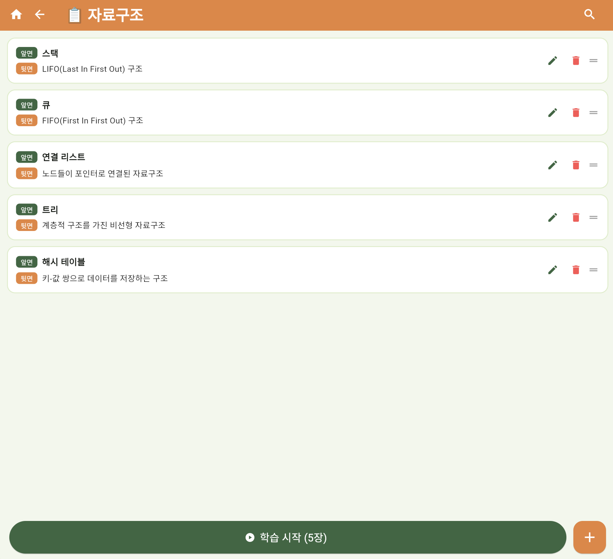
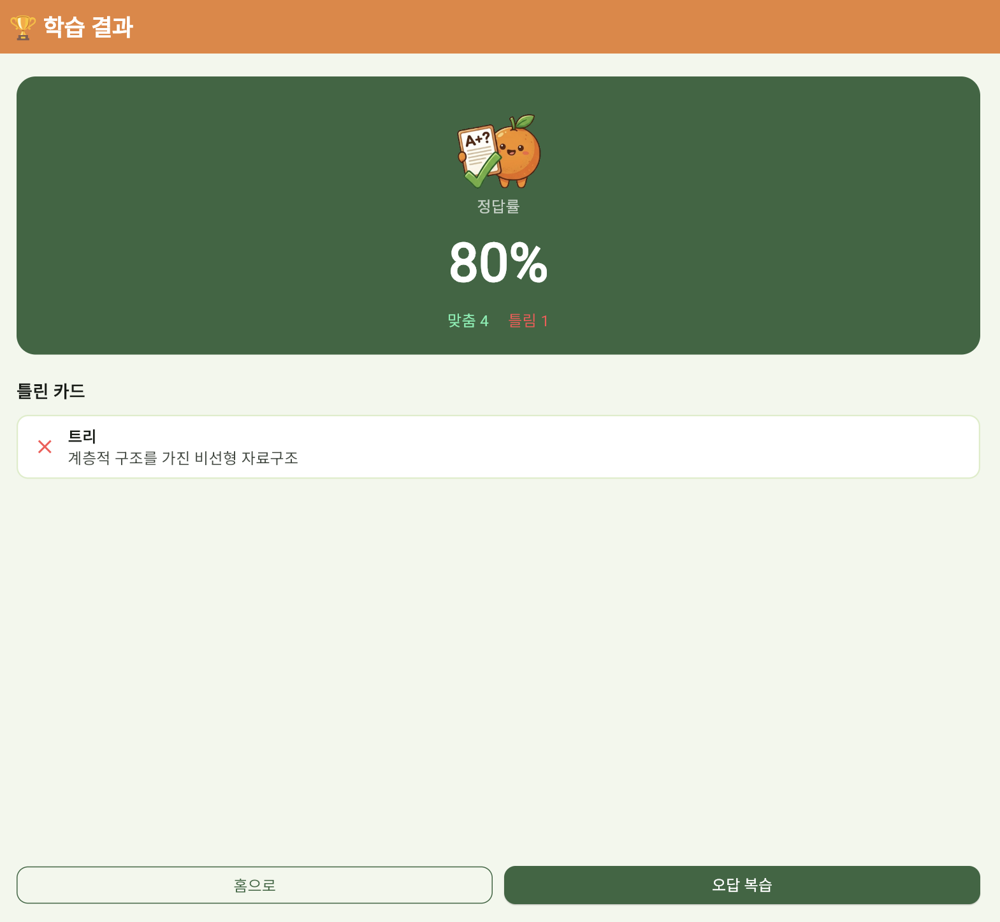
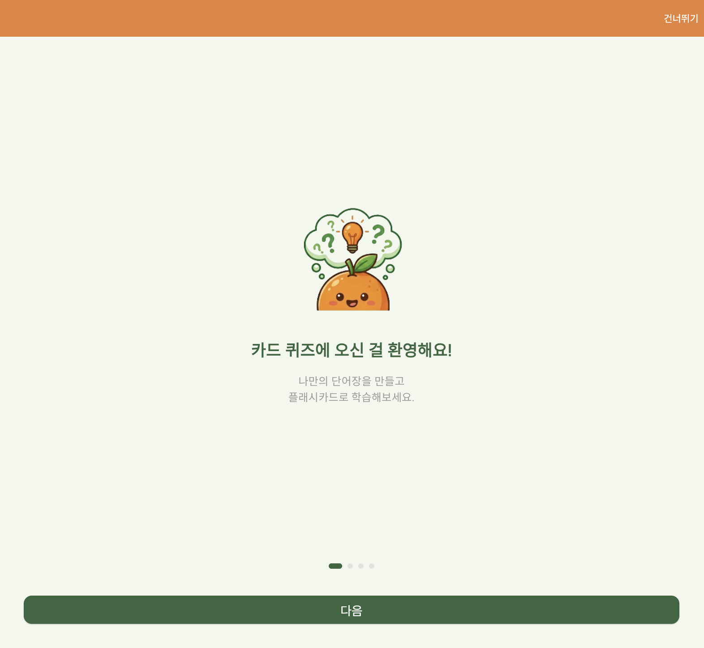
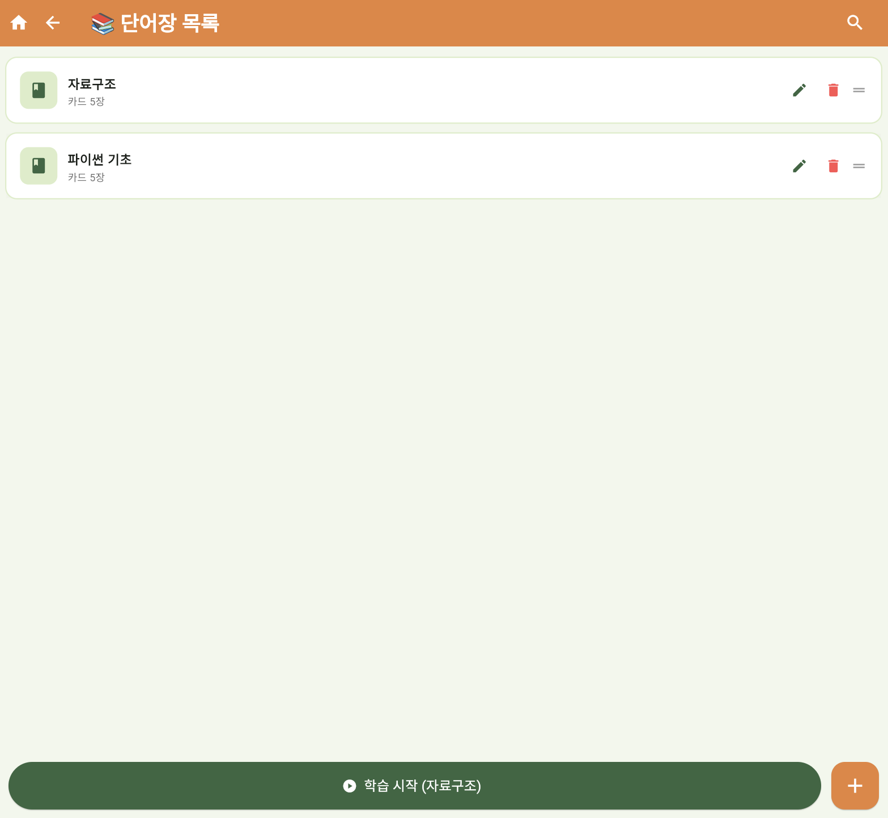
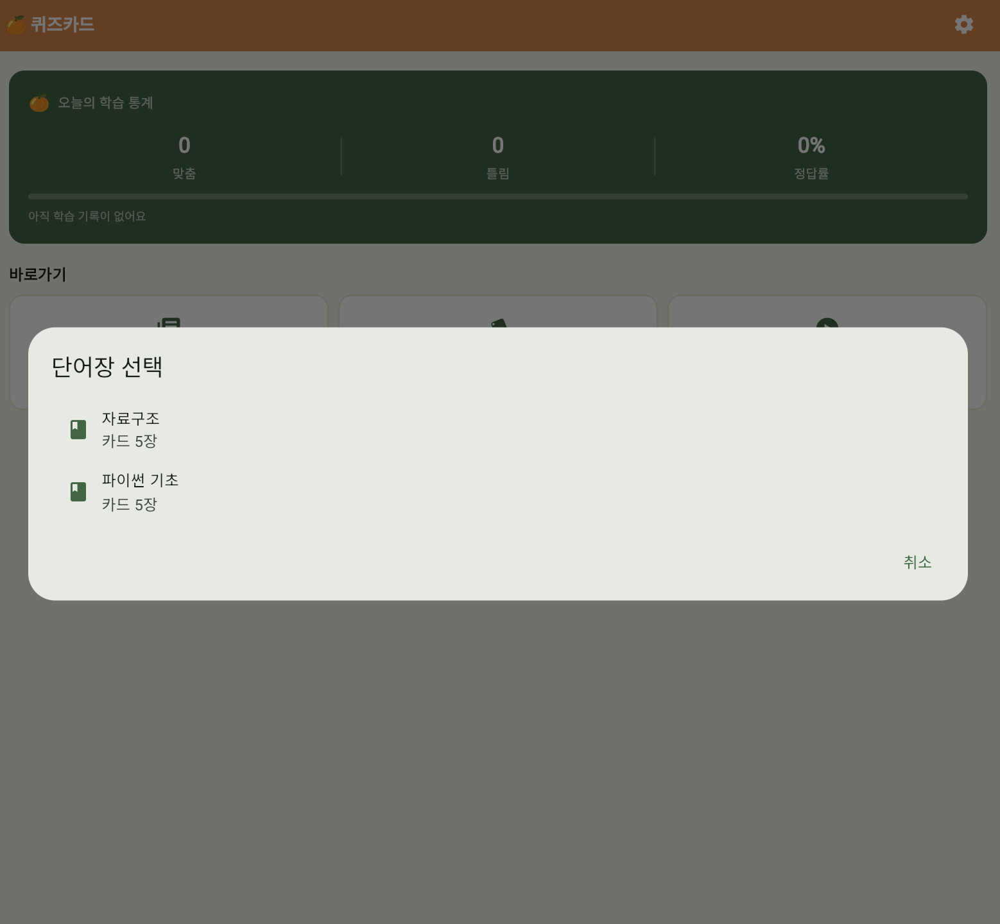
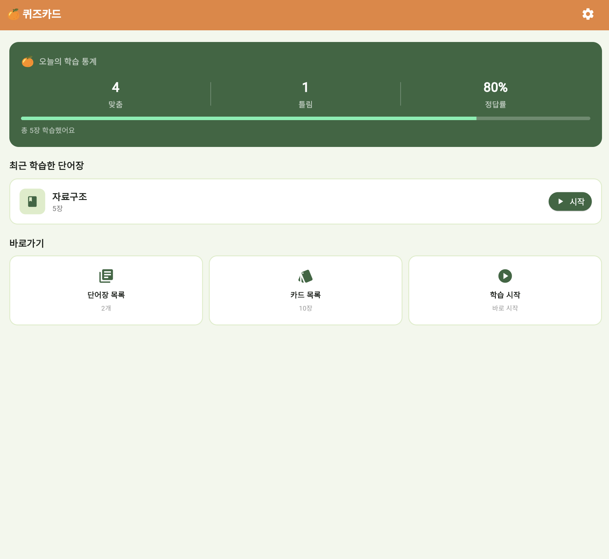
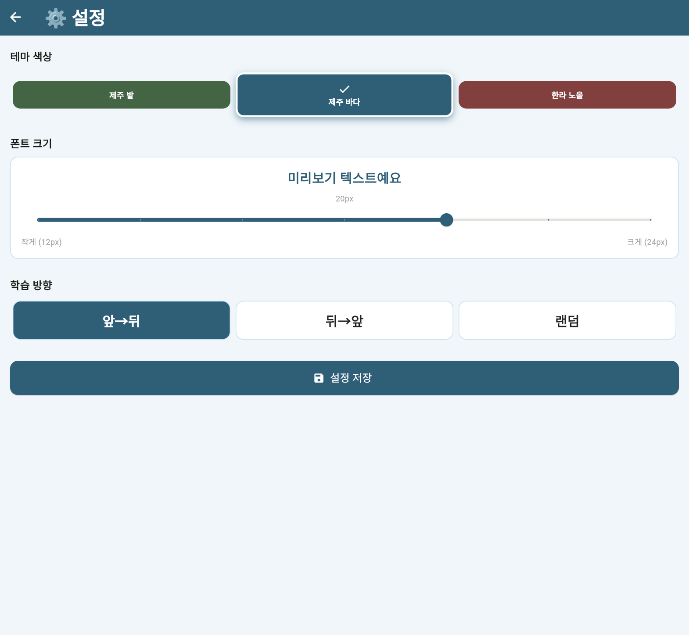

# Card Quiz

Flutter 기반 플래시카드 단어장 학습 웹 앱. 라인편집기(Line Editor)의 추가, 삭제, 수정, 출력, 저장, 불러오기 개념을 단어장 앱에 응용한 CRUD 중심 실습 프로젝트. 카드 학습, 오답 복습, 테마 설정은 부가 기능으로 구현.


## 기술 스택

| 구분 | 기술 | 용도 |
|---|---|---|
| 언어 | Dart | 전체 앱 코드 |
| 프레임워크 | Flutter (Material 3) | 화면 구성, ReorderableListView 드래그 순서 변경, Slider 글자 크기 조절, AlertDialog와 SnackBar 입력 처리 |
| 표준 라이브러리 | dart:convert | jsonEncode, jsonDecode로 단어장 JSON 변환 |
| 외부 라이브러리 | provider | AppSettings(ChangeNotifier)로 테마, 글자 크기, 학습 방향 전역 반영 |
| 외부 라이브러리 | shared_preferences | 단어장, 설정, 학습 통계, 최근 학습 단어장 로컬 저장 및 앱 시작 시 로드 |
| 외부 라이브러리 | cupertino_icons | 아이콘 |

## 구현 역량

Flutter 위젯과 Provider 상태 관리 기반 CRUD 앱 구현, JSON 직렬화 후 SharedPreferences 저장. 관련 이론 문서와 코드는 [파이썬 기초 역량 정리](https://github.com/Jenny5789/python/tree/main/study_archive) 참조.

| 역량 | 구현 내용 | 코드 | 이론 |
|---|---|---|---|
| 데이터 CRUD | 단어장, 카드의 추가, 수정, 삭제, 드래그 순서 변경, 검색 구현. 앞면 빈 값 저장 방지 검증 | [핵심 코드](#핵심-코드) | [줄 편집기 insert, delete, replace, print_all](https://github.com/Jenny5789/python/blob/main/study_archive/data_structures/02_line_editor.py) |
| 로컬 영속성 | 단어장, 설정, 통계의 SharedPreferences 저장과 시작 시 로드. 최초 실행 시 샘플 단어장 2개 생성 | [storage_service.dart](lib/services/storage_service.dart) | [줄 편집기 save, load](https://github.com/Jenny5789/python/blob/main/study_archive/data_structures/02_line_editor.py), [파일 입출력](https://github.com/Jenny5789/python/blob/main/study_archive/theory/15_file_io_csv_excel.md) |
| 데이터 모델링과 직렬화 | Deck, CardItem 클래스 정의, toJson/fromJson 변환, 카드별 틀린 횟수(wrongCount) 저장 | [deck.dart](lib/models/deck.dart), [card_item.dart](lib/models/card_item.dart) | [클래스와 객체지향](https://github.com/Jenny5789/python/blob/main/study_archive/theory/14_classes_oop.md), [자료형(list, dict)](https://github.com/Jenny5789/python/blob/main/study_archive/theory/03_data_types.md) |
| 상태 관리 | ChangeNotifier 상속 AppSettings를 Provider로 주입, 설정 변경의 MaterialApp 테마와 글자 크기 즉시 반영 | [app_settings.dart](lib/services/app_settings.dart), [main.dart](lib/main.dart) | [상속](https://github.com/Jenny5789/python/blob/main/study_archive/theory/14_classes_oop.md) |
| 학습 로직 | 카드 뒤집기, 맞춤/틀림 집계, 학습 방향별 출제(앞면 먼저, 뒷면 먼저, 랜덤 shuffle), 원본 카드 복사 후 사용, 틀린 카드만 모은 오답 복습 단어장 생성 | [study_screen.dart](lib/screens/study_screen.dart), [result_screen.dart](lib/screens/result_screen.dart) | [흐름 제어](https://github.com/Jenny5789/python/blob/main/study_archive/theory/07_flow_control.md), [얕은 복사와 깊은 복사](https://github.com/Jenny5789/python/blob/main/study_archive/theory/03_data_types.md) |
| 화면 구성 | 7개 화면 screens 폴더 분리, 최초 실행 시에만 온보딩 분기 | [main.dart](lib/main.dart), [screens](lib/screens) | [줄 편집기 print_all](https://github.com/Jenny5789/python/blob/main/study_archive/data_structures/02_line_editor.py) |

## 핵심 코드

### 데이터 CRUD

[lib/screens/card_list_screen.dart](lib/screens/card_list_screen.dart)

```dart
// 추가 (라인편집기 insert)
widget.deck.cards.add(CardItem(
  front: frontController.text,
  back: backController.text,
));

// 수정 (라인편집기 replace)
card.front = frontController.text;
card.back = backController.text;

// 삭제 (라인편집기 delete)
widget.deck.cards.remove(card);

// 순서 변경
final card = widget.deck.cards.removeAt(oldIndex);
widget.deck.cards.insert(newIndex, card);

// 모든 변경 뒤 저장 요청
widget.onCardsChanged();
```

- 라인편집기의 insert, replace, delete를 카드 리스트 조작으로 대응
- 앞면이 비어 있으면 추가, 수정을 막고 SnackBar로 안내
- 자식 화면은 onCardsChanged 콜백으로 변경만 알리고, 저장은 HomeScreen의 _onDecksChanged에서 일괄 처리

## 주요 기능

| 기능 | 설명 |
|---|---|
| 단어장 관리 | 추가, 수정, 삭제, 드래그 순서 변경, 이름 검색 |
| 카드 관리 | 앞면과 뒷면 추가, 수정, 삭제, 드래그 순서 변경, 검색 |
| 학습 시작 | 홈에서 단어장 선택 후 학습 시작, 카드 탭으로 뒤집기, 맞춤/틀림 체크 |
| 학습 결과와 오답 복습 | 정답률과 틀린 카드 목록 표시, 틀린 카드만 재학습 |
| 홈 통계 | 맞춤, 틀림 횟수와 정답률, 최근 학습 단어장 표시 |
| 설정 | 테마 3종(제주 밭, 제주 바다, 한라 노을), 글자 크기 12px~24px, 학습 방향(앞면 먼저, 뒷면 먼저, 랜덤) |
| 온보딩 | 최초 실행 시 사용법 안내, 건너뛰기 지원 |




<details>
<summary>전체 화면 보기</summary>

**온보딩**



**단어장 목록**



**단어장 선택**



**학습 후 홈 화면**



**설정**



</details>

## 파일 구조

```
card_quiz/
├── lib/
│   ├── main.dart
│   ├── theme/
│   │   └── colors.dart
│   ├── models/
│   │   ├── card_item.dart
│   │   ├── deck.dart
│   │   └── today_stats.dart
│   ├── services/
│   │   ├── storage_service.dart
│   │   └── app_settings.dart
│   └── screens/
│       ├── home_screen.dart
│       ├── deck_list_screen.dart
│       ├── card_list_screen.dart
│       ├── study_screen.dart
│       ├── result_screen.dart
│       ├── settings_screen.dart
│       └── onboarding_screen.dart
├── assets/images/
└── pubspec.yaml
```

플랫폼 폴더(android, ios, web 등) 생략.

## 실행 방법

```
flutter pub get
flutter run -d chrome
```